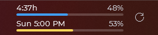

# Claude Usage Widget

A Windows widget that shows your Claude subscription usage right on the taskbar, next to
the system tray: two bars, the 5-hour window and the weekly window, with the same data you
see when you type `/usage` inside Claude Code.

No tabs to open, no commands to remember — the number that matters, always in sight.

## What it does

- **Real data**, not an estimate: it queries the same endpoint Claude Code uses,
  authenticated with the session you already have.
- **Two bars**, 5-hour usage and weekly usage, each with its percentage and its
  reset time.
- **Color by usage**, the same on both bars: blue below 50%, yellow below 70%, orange
  below 85% and red from there on.
- **Part of the taskbar**: it is a child window of the taskbar itself, so it moves, hides
  and stacks with the taskbar. It sits right before the system tray, follows the tray when
  it grows or shrinks, matches the taskbar's dark or light mode, and steps aside with the
  taskbar when an app goes full screen. There is no window to place or resize.
- **Good neighbor**: when another app has already docked its own widget against the
  system tray, it docks next to that widget instead of covering it.
- **Refresh button**: asks for your usage again right now instead of waiting for the next
  automatic reading.

## Download and run

1. Go to [Releases](https://github.com/Ian8476/ClauWid/releases/latest) and download
   `ClaudeUsageWidget-win-x64.zip`.
2. Unzip it into any folder (the `.exe` needs the `Assets` folder next to it, for the
   font).
3. Run `ClaudeUsageWidget.exe`.

**Requirements:**

- Windows 11. Windows 10 has the same taskbar structure, but the widget has not been tried
  there.
- [.NET 8 Desktop Runtime](https://dotnet.microsoft.com/download/dotnet/8.0) installed
  (the `.exe` does not bundle it).
- [Claude Code](https://claude.com/claude-code) installed and signed in
  (`claude`, then `/login`). The widget reads the token from there; it never asks for
  credentials of its own.

## Usage

The menus are in Spanish; the labels below are shown as they appear in the app.

| Action | How |
|---|---|
| Read your usage again now | Click the refresh button, or right-click → "Actualizar ahora" |
| Hide it | Right-click → "Ocultar" (bring it back from the tray icon → "Mostrar widget") |
| Quit | Right-click → "Salir", or tray icon → "Salir" |

The widget takes the space right before the system tray on the primary taskbar. With enough
apps open for their icons to reach that far, it covers the last ones: Windows does not know
the space is taken.

If you see `--` instead of a percentage, the widget couldn't read your usage: check that
Claude Code has an active session (`claude` in a terminal). The data doesn't vanish all
at once — while the source is down, the widget keeps the last known reading.

## Where the data comes from

The widget reads the OAuth token that Claude Code stores in
`%USERPROFILE%\.claude\.credentials.json` (or in `CLAUDE_CONFIG_DIR`, if you have it
set) and queries `https://api.anthropic.com/api/oauth/usage` every minute, and whenever you
press the refresh button. If the API answers that it is being asked too often, the widget
stops asking for as long as it is told to, button included, and keeps the last reading.

- **It never refreshes the token on its own:** doing so would rotate the refresh token
  and sign Claude Code out. When it finds the token expired, which is common if you only
  work with the desktop app, it runs `claude doctor` in the background, with no window
  and at most once every 15 minutes: that way it's Claude Code's own CLI that checks its
  session and renews it. That command doesn't consume quota. Meanwhile, the widget keeps
  the last known data.
- **Nothing leaves your machine** except that query to the Anthropic API with your own
  token. There's no telemetry and no intermediate server.
- **Undocumented endpoint**, the same one Claude Code uses internally, and it may change
  without notice. If it changes, the widget shows `--` instead of making up a number.

## Credits

Montserrat Medium is embedded in `src/ClaudeUsageWidget.Presentation.Wpf/Assets/Fonts`
under the [SIL Open Font License 1.1](src/ClaudeUsageWidget.Presentation.Wpf/Assets/Fonts/OFL.txt).

This project is not affiliated with Anthropic. "Claude" is a trademark of Anthropic PBC.
